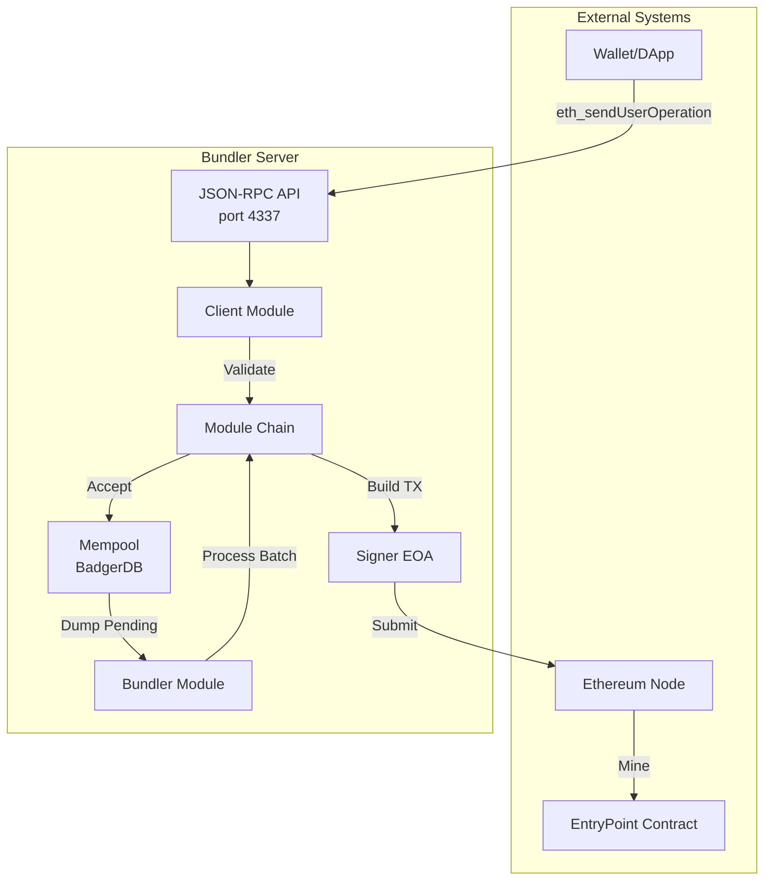
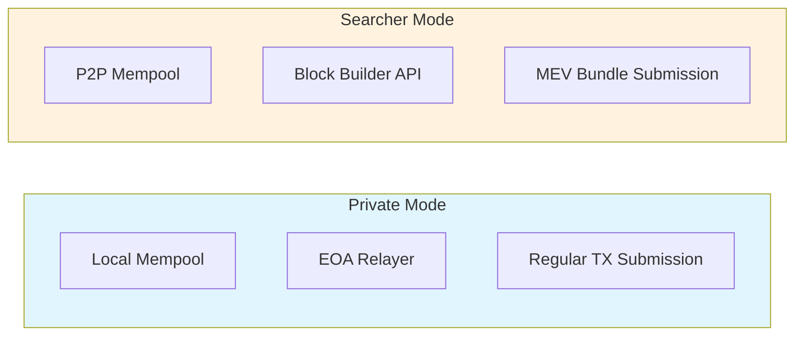
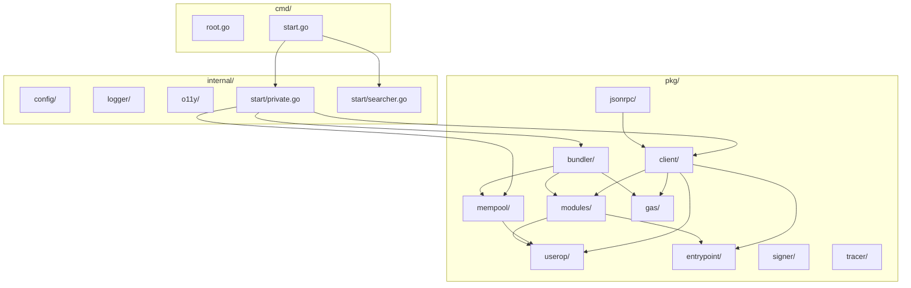
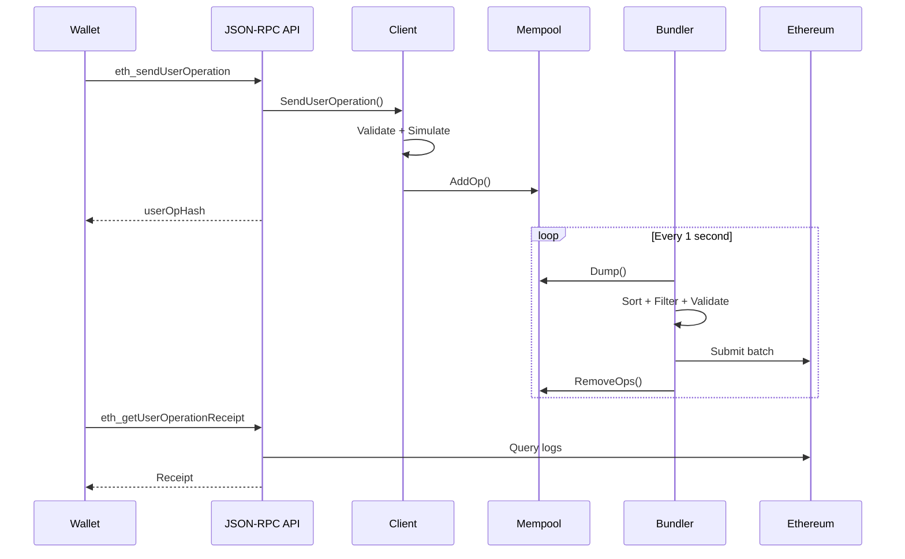
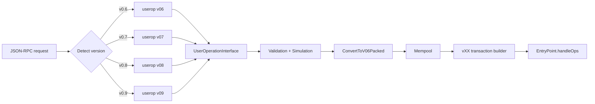

# Architecture

This document describes the high-level architecture of the qubenode-bundler, a Go implementation of an [ERC-4337](https://eips.ethereum.org/EIPS/eip-4337) Bundler supporting EntryPoint versions **v0.6, v0.7, v0.8, and v0.9** from a single binary.

## Overview

The bundler is an off-chain actor that packages `UserOperations` (account abstraction transactions) and submits them to the Ethereum `EntryPoint` contract. It operates as an HTTP JSON-RPC server that accepts `UserOperations`, validates them, stores them in a local mempool, and periodically batches them for on-chain execution.

## System Architecture



## Two-Mode Architecture

The bundler supports two distinct operating modes:

### Private Mode

In private mode, the bundler operates with a local mempool and sends transactions directly via an EOA (Externally Owned Account). This mode is compatible with all EVM networks but is vulnerable to frontrunning.



### Searcher Mode

In searcher mode, the bundler integrates with Flashbots or block builder APIs to submit bundles via MEV protection. This requires a compatible chain (Ethereum mainnet/Goerli/Sepolia) and builder URLs.

## Component Breakdown

### 1. HTTP Server (`pkg/jsonrpc/`)

Gin-based HTTP server exposing JSON-RPC endpoints on port 4337.

### 2. Client (`pkg/client/`)

Processes incoming `UserOperations` through validation middleware:
- Sanity checks (gas limits, fees, sender)
- EntryPoint simulation (`simulateValidation`)
- Reputation scoring
- Mempool insertion

### 3. Mempool (`pkg/mempool/`)

Persistent pending transaction pool backed by BadgerDB:
- Survives process restarts
- Organized by EntryPoint and sender address
- FIFO ordering for batching

### 4. Bundler (`pkg/bundler/`)

Timer-driven batch processor (runs every 1 second):
- Dumps pending ops from mempool
- Fetches current gas prices
- Executes batch middleware chain
- Removes processed/dropped ops

### 5. Signer (`pkg/signer/`)

EOA key management and transaction signing.

### 6. Modules (`pkg/modules/`)

Composable middleware for both Client and Bundler:
- **Client modules**: Validate individual ops
- **Bundler modules**: Process batches before submission

## Package Structure



## Module System

The architecture uses two types of middleware handlers:

| Handler Type | Function Signature | Used By | Purpose |
|-------------|-------------------|---------|---------|
| `UserOpHandlerFunc` | `func(ctx *UserOpHandlerCtx) error` | Client | Validate single UserOperation |
| `BatchHandlerFunc` | `func(ctx *BatchHandlerCtx) error` | Bundler | Process batch of UserOperations |

Modules are composed into chains using `ComposeUserOpHandlerFunc` and `ComposeBatchHandlerFunc`.

### Client Module Chain (Private Mode)

```
1. rep.CheckStatus()       - Check entity reputation
2. rep.ValidateOpLimit()   - Validate ops seen limit
3. check.ValidateOpValues() - Sanity checks (gas, fees, sender)
4. check.SimulateOp()      - EntryPoint simulation
5. rep.IncOpsSeen()        - Increment ops seen counter
```

### Bundler Module Chain (Private Mode)

```
1. exp.DropExpired()              - Remove expired ops
2. gasprice.SortByGasPrice()      - Sort by gas price
3. gasprice.FilterUnderpriced()   - Filter underpriced ops
4. batch.SortByNonce()            - Sort by nonce
5. batch.MaintainGasLimit()       - Enforce batch gas limit
6. check.PaymasterDeposit()       - Verify paymaster deposits
7. check.SimulateBatch()          - Batch simulation (placeholder)
8. relayer.SendUserOperation()    - Submit via EOA
9. rep.IncOpsIncluded()           - Increment ops included
10. check.Clean()                 - Clean up DB entries
```

### Searcher Mode Differences

Searcher mode replaces the relayer with a builder module and adds code hash verification:

```diff
- relayer.SendUserOperation()
+ builder.SendUserOperation()

+ check.CodeHashes()              - Verify contract code hasn't changed
```

## Data Flow Summary



## Key Dependencies

| Package | Purpose |
|---------|---------|
| `go-ethereum` | Ethereum client, ABI bindings, crypto |
| `gin` | HTTP server framework |
| `cobra` + `viper` | CLI and configuration |
| `badger/v3` | Embedded persistent database |
| `flashbotsrpc` | Block builder API integration |
| `opentelemetry` | Observability (traces and metrics) |
| `zerolog` | Structured logging |

## Network Support

The bundler supports multiple EVM networks with chain-specific configurations:

| Network | Chain ID | Special Handling |
|---------|----------|-----------------|
| Ethereum Mainnet | 1 | Standard |
| Goerli | 5 | Standard |
| Sepolia | 11155111 | Standard |
| Optimism | 10 | OP Stack gas oracle |
| Arbitrum One | 42161 | Arbitrum gas buffer |
| Base | 8453 | OP Stack gas oracle |
| Lyra | 957 | OP Stack gas oracle |
| Ancient8 Sepolia | 28122024 | OP Stack gas oracle |

For L2 networks, the bundler adjusts PreVerificationGas calculations using network-specific gas oracles.

## EntryPoint Support

Default supported EntryPoint: `0x5FF137D4b0FDCD49DcA30c7CF57E578a026d2789`

This is configurable via the `ERC4337_BUNDLER_SUPPORTED_ENTRY_POINTS` environment variable.

## Version-Aware Architecture

The bundler supports four ERC-4337 versions concurrently. The version is resolved
at startup from the EntryPoint address (or the `ERC4337_BUNDLER_ENTRYPOINT_VERSION`
override) and stored on `config.Values.EntryPointVersion`. See
[Configuration](./CONFIGURATION.md#entrypoint-version-detection).

### Versioned UserOperation model

Each version has its own `UserOperation` struct under `pkg/userop/`:

| Package | Version | Notable fields |
|---------|---------|----------------|
| `pkg/userop` (root) | v0.6 | `initCode`, `paymasterAndData` |
| `pkg/userop/v07` | v0.7 | `factory`/`factoryData`, split paymaster gas limits |
| `pkg/userop/v08` | v0.8 | v0.7 + `eip7702Auth`, ERC-712 `userOpHash` |
| `pkg/userop/v09` | v0.9 | v0.8 + `paymasterSignature` (excluded from hash) |

All four structs implement `userop.UserOperationInterface`, so the validation,
gas, and mempool code can operate on any version through a common set of getters
(`GetFactory()`, `GetPaymasterData()`, `GetUserOpHash()`, `Pack()`, …).

- `userop.NewUserOperation(version, data)` constructs the right struct.
- `userop.DetectVersionFromEntryPoint(addr)` and `DetectVersion(data)` resolve the
  version from the EntryPoint address or the request body shape.
- The client routes requests with `parseVersionedUserOp(op, ep)`; per-version
  bindings/filters live in `pkg/entrypoint/v07|v08|v09/`.

### Canonical packed form

After validation, every version is normalized to the **v0.6 packed**
`UserOperation` via `userop.ConvertToV06Packed(op)` before it enters the mempool.
The mempool, batch pipeline, and transaction-building code therefore operate on a
single shape, while version-specific encoding is reapplied by the
`pkg/entrypoint/vXX/transaction` packages when building the on-chain `handleOps`
call.



### EIP-7702 flow (v0.8+)

EIP-7702 lets an EOA act as the smart-account sender by delegating to account
code. In a UserOperation this is signalled by the `factory` field holding the
left-aligned marker `0x7702...` (`EIP7702MarkerFactory`) together with an
`eip7702Auth` authorization tuple.

- The marker is expanded during parsing (`normalizeOptionalFields`) so it is not
  right-aligned into a normal address.
- For a marker op, the EntryPoint overrides the initCode hash with
  `keccak(delegateAddress || factoryData)`; the bundler mirrors this in
  `hashInitCode()` so the computed `userOpHash` matches on-chain.
- The authorization tuple is carried in-memory and surfaced to simulation; it is
  not part of the canonical packed mempool form.

### Paymaster signature flow (v0.9)

v0.9 adds a `paymasterSignature` field that is **excluded from the `userOpHash`**,
allowing the paymaster to sign in parallel with the account. The paymaster RPC
(`pm_sponsorUserOperation`) returns the signature separately rather than appended
to `paymasterAndData`; `pkg/handlers/payg` branches on the v0.9 struct to produce
this response shape, and `PackForSignature()` omits the field when hashing.

## Observability

Optional OpenTelemetry integration provides:
- Distributed tracing via OTLP/gRPC
- Metrics collection (mempool size gauge)
- Request logging with trace context

Enable by setting `ERC4337_BUNDLER_OTEL_SERVICE_NAME` and `ERC4337_BUNDLER_OTEL_COLLECTOR_URL`.
