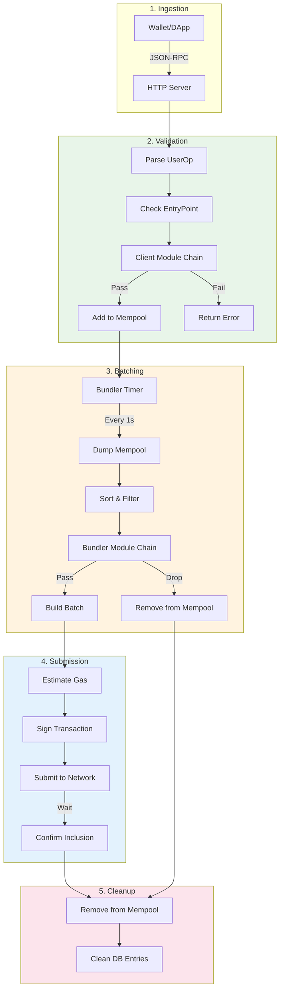
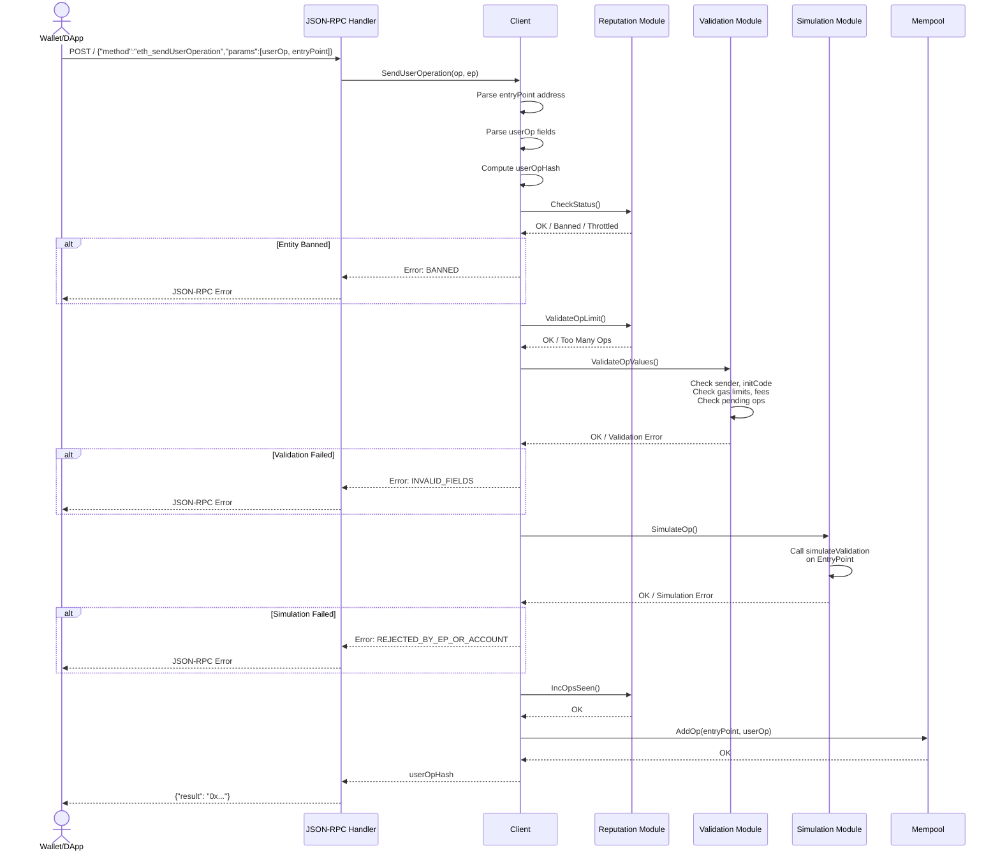
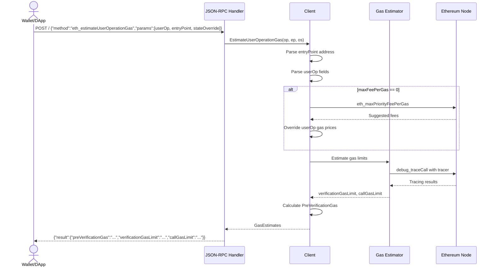
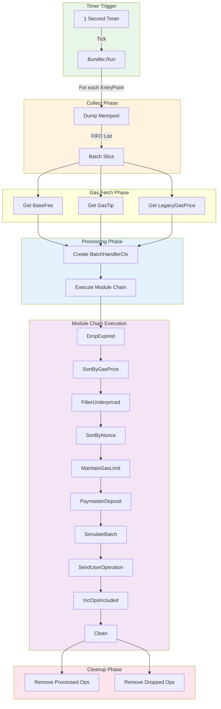
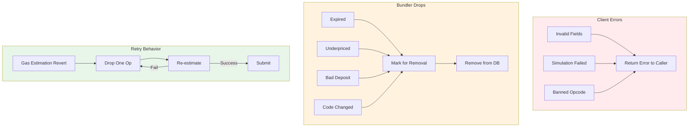
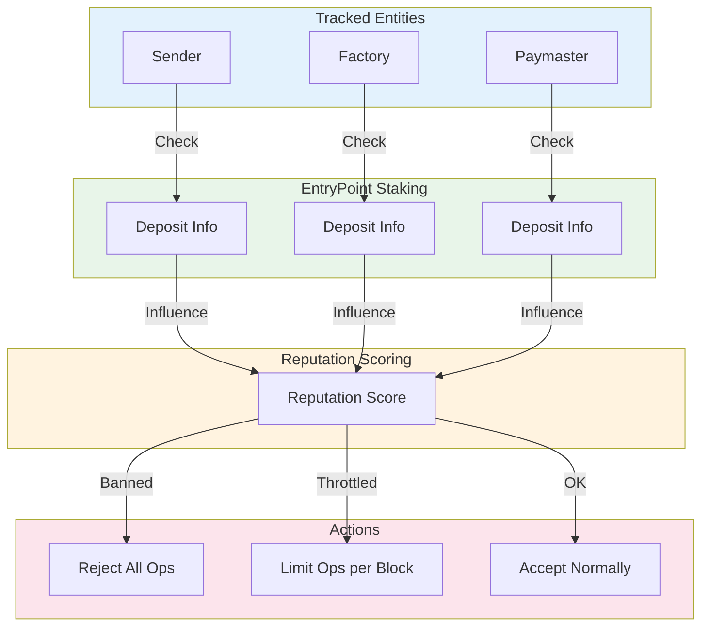
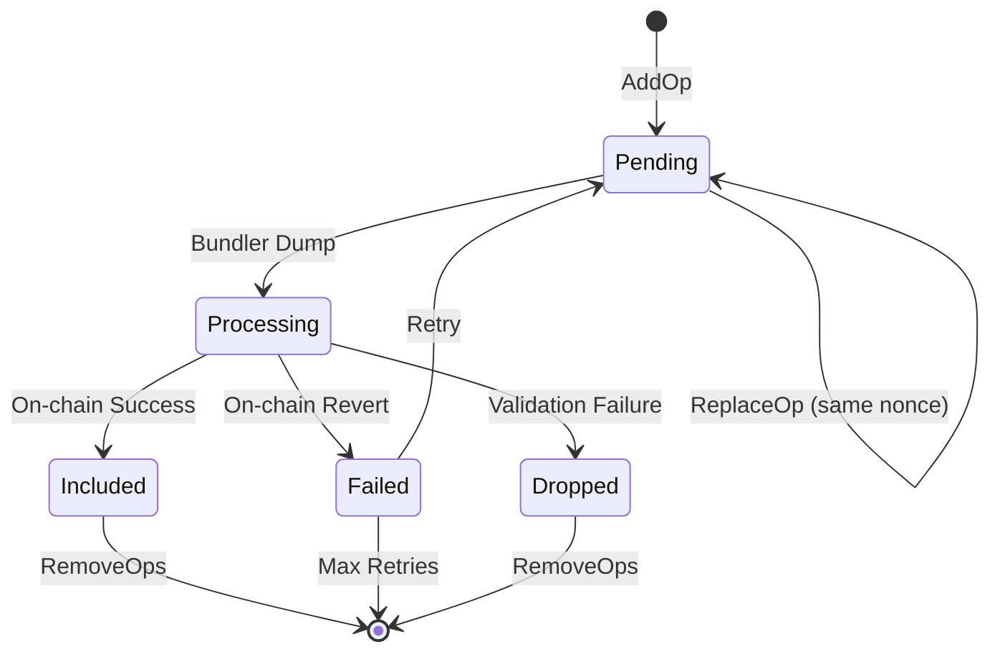
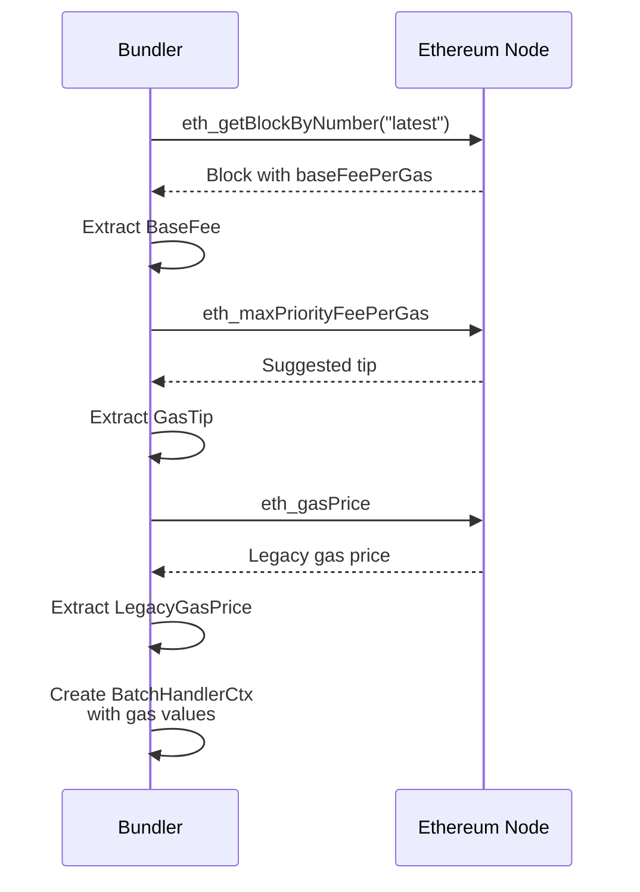
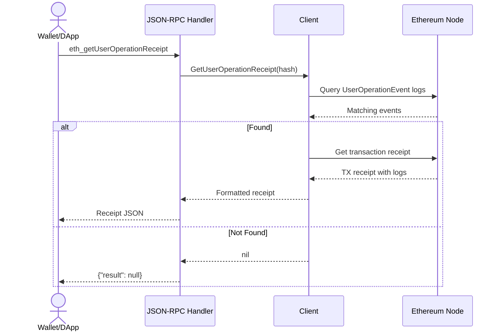

# Data Flow

This document details the lifecycle of a `UserOperation` through the bundler system, including request flows, batch processing, and error handling paths.

## UserOperation Lifecycle

## Request Flow: `eth_sendUserOperation`

## Request Flow: `eth_estimateUserOperationGas`

## Batch Processing Flow

## Error Handling and Removal Paths

### Client-Side Validation Errors

| Error Code | Trigger | Module | Action |
|-----------|---------|--------|--------|
| `INVALID_FIELDS` | Bad gas limits, fees, nonce | `ValidateOpValues` | Reject, don't add to mempool |
| `REJECTED_BY_EP_OR_ACCOUNT` | Simulation reverts | `SimulateOp` | Reject, don't add to mempool |
| `INVALID_SIGNATURE` | Signature check fails | `SimulateOp` | Reject, don't add to mempool |
| `BANNED_OPCODE` | Banned opcode detected | `SimulateOp` | Reject, don't add to mempool |
| `SHORT_DEADLINE` | Expires within 30s | `SimulateOp` | Reject, don't add to mempool |

### Bundler-Side Removal Reasons

| Reason | Trigger | Module | Action |
|--------|---------|--------|--------|
| `expired` | TTL exceeded | `DropExpired` | Mark for removal |
| `underpriced` | Gas price too low | `FilterUnderpriced` | Mark for removal |
| `insufficient paymaster deposit` | Paymaster can't cover gas | `PaymasterDeposit` | Mark for removal |
| `code hash changed` | Contract code updated | `CodeHashes` | Mark for removal |
| Simulation revert | Batch simulation fails | `SimulateBatch` | Mark for removal |

## Reputation System Flow

## Mempool State Transitions

## Gas Price Update Flow

The bundler fetches gas prices at the start of each batch processing cycle:

## Receipt Query Flow

